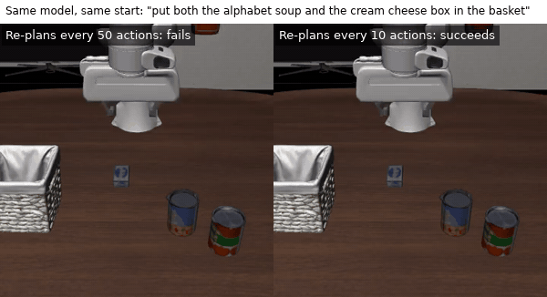
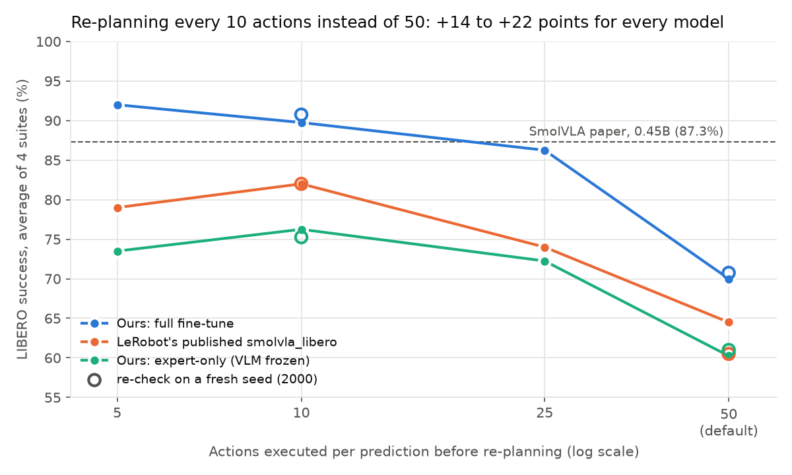

# SmolVLA Fine-Tuning on LIBERO

Fine-tunes [SmolVLA](https://huggingface.co/papers/2506.01844), a 450M-parameter vision-language-action model,
from `lerobot/smolvla_base` on the [LIBERO](https://libero-project.github.io/) simulated manipulation
benchmark with LeRobot. It evaluates success on all four suites (Spatial, Object, Goal, Long), with LeRobot's
published `lerobot/smolvla_libero` checkpoint evaluated the same way as a reference, and studies two choices:
**how often the policy re-plans**, and **whether the vision-language model is trained or frozen**.



*Our fine-tuned model on the same LIBERO-Long task and start state. Left: it executes 50 predicted actions
before looking again and fails. Right: it re-plans every 10 actions and puts both items in the basket.*

## Findings

1. **Our full fine-tune reaches 90.8% average success** (92 / 97 / 94 / 80 on Spatial / Object / Goal / Long)
   on a fresh evaluation seed, against **82.0%** for LeRobot's published `smolvla_libero` evaluated identically
   and **87.3%** reported in the SmolVLA paper. It used a quarter of the paper's training steps (25k vs 100k).
2. **Re-planning more often matters more than anything else measured.** Executing 10 actions per prediction
   instead of the checkpoint default of 50 adds **14–22 points for every model**, on both evaluation seeds.
   Going to 5 helps our full fine-tune further (92.0%) but hurts the other two models, so 10 is the robust
   choice.
3. **Training the vision-language model, not just the action expert, is worth about 15 points**: 90.8% vs 75.2%
   at the same recipe otherwise (both on seed 2000, re-planning every 10).



## Results

Each row is 400 episodes: 4 suites × 10 tasks × 10 episodes, with LeRobot's fixed LIBERO initial states.
Eval seed 1000 was used to compare settings; seed 2000 is a re-check on different episodes.
95% Wilson intervals on the 400-episode average.

| Model | Re-plan every (actions) | Eval seed | Spatial | Object | Goal | Long | **Average** (95% CI) |
|---|---|---|---|---|---|---|---|
| **Ours: full fine-tune** | 10 | **2000** | 92 | 97 | 94 | 80 | **90.8** (88–93) |
| LeRobot's published smolvla_libero | 10 | **2000** | 79 | 88 | 88 | 73 | **82.0** (78–86) |
| Ours: expert-only (VLM frozen) | 10 | **2000** | 76 | 86 | 83 | 56 | **75.2** (71–79) |
| SmolVLA paper (0.45B), re-plans every action | 1 | — | 90 | 96 | 92 | 71 | **87.3** |

<details>
<summary>All 18 runs (3 models × re-planning intervals × seeds)</summary>

| Model | Re-plan every (actions) | Eval seed | Spatial | Object | Goal | Long | **Average** (95% CI) |
|---|---|---|---|---|---|---|---|
| Ours: full fine-tune | 50 | 1000 | 67 | 78 | 85 | 50 | **70.0** (65–74) |
| Ours: full fine-tune | 25 | 1000 | 82 | 95 | 90 | 78 | **86.2** (82–89) |
| Ours: full fine-tune | 10 | 1000 | 91 | 98 | 91 | 79 | **89.8** (86–92) |
| Ours: full fine-tune | 5 | 1000 | 91 | 100 | 92 | 85 | **92.0** (89–94) |
| Ours: full fine-tune | 50 | 2000 | 70 | 83 | 84 | 46 | **70.8** (66–75) |
| Ours: full fine-tune | 10 | 2000 | 92 | 97 | 94 | 80 | **90.8** (88–93) |
| LeRobot's published smolvla_libero | 50 | 1000 | 64 | 68 | 79 | 47 | **64.5** (60–69) |
| LeRobot's published smolvla_libero | 25 | 1000 | 69 | 84 | 82 | 61 | **74.0** (70–78) |
| LeRobot's published smolvla_libero | 10 | 1000 | 79 | 92 | 88 | 69 | **82.0** (78–86) |
| LeRobot's published smolvla_libero | 5 | 1000 | 81 | 87 | 82 | 66 | **79.0** (75–83) |
| LeRobot's published smolvla_libero | 50 | 2000 | 55 | 65 | 71 | 51 | **60.5** (56–65) |
| LeRobot's published smolvla_libero | 10 | 2000 | 79 | 88 | 88 | 73 | **82.0** (78–86) |
| Ours: expert-only (VLM frozen) | 50 | 1000 | 68 | 66 | 66 | 41 | **60.2** (55–65) |
| Ours: expert-only (VLM frozen) | 25 | 1000 | 76 | 86 | 86 | 41 | **72.2** (68–76) |
| Ours: expert-only (VLM frozen) | 10 | 1000 | 76 | 85 | 88 | 56 | **76.2** (72–80) |
| Ours: expert-only (VLM frozen) | 5 | 1000 | 67 | 89 | 84 | 54 | **73.5** (69–78) |
| Ours: expert-only (VLM frozen) | 50 | 2000 | 64 | 64 | 73 | 43 | **61.0** (56–66) |
| Ours: expert-only (VLM frozen) | 10 | 2000 | 76 | 86 | 83 | 56 | **75.2** (71–79) |
| SmolVLA paper (0.45B), re-plans every action | 1 | — | 90 | 96 | 92 | 71 | **87.3** |

</details>

## What was done

| Step | Details |
|---|---|
| **Full fine-tune** | `lerobot/smolvla_base` on `lerobot/libero` (1,693 demos, 40 tasks), recipe of LeRobot's published `smolvla_libero`: vision encoder, VLM and action expert all trained (393M trainable parameters), lr 1e-4, 1k warm-up, cosine decay over 25k steps, effective batch 32 (2 GPUs × 16). 7 h 08 min on 2× RTX 4000 SFF Ada (20 GB); final loss 0.307. |
| **Expert-only fine-tune** | Same data and steps, but with `smolvla_base`'s own defaults: vision encoder and VLM frozen, only the 100M action expert trained, decay over 30k steps; batch 32 on 1 GPU, 6 h 25 min, final loss 0.340. |
| **Evaluation** | `lerobot-eval` on all 4 suites, 10 episodes per task, at 50 / 25 / 10 / 5 actions executed per prediction (`--policy.n_action_steps`), seed 1000; the main settings re-checked on seed 2000. |
| **Reference** | LeRobot's published `lerobot/smolvla_libero`, evaluated with the same commands. |

How the expert-only run came about: the first fine-tune was started from `smolvla_base` with only the step
count and batch size overridden, so it silently inherited the base model's "freeze the VLM" defaults rather
than the published recipe. It was kept as an ablation, and the training job now requires the recipe to be
named explicitly ([`jobs/train_smolvla.sbatch`](jobs/train_smolvla.sbatch), `VARIANT=full|expert`).

## Reproduce

Tested with LeRobot 0.6.1, Python 3.12 and CUDA 12.8 PyTorch wheels (NVIDIA driver >= 570); exact versions in
`requirements.lock.txt`. Jobs run under SLURM: copy `cluster.local.env.example` to `cluster.local.env`.

```bash
CONDA_ROOT=/path/to/miniconda3 bash scripts/setup_env.sh
VARIANT=full RUN_NAME=smolvla_libero_full BATCH_SIZE=16 SAVE_FREQ=5000 \
  scripts/submit.sh jobs/train_smolvla.sbatch --gres=gpu:2          # ~7 h on 2x 20 GB GPUs
CKPT=outputs/train/smolvla_libero_full/checkpoints/last/pretrained_model \
TASK=libero_spatial,libero_object,libero_goal,libero_10 N_ACTION_STEPS=10 SEED=2000 RUN_NAME=full_all_nas10_s2000 \
  scripts/submit.sh jobs/eval_libero.sbatch                         # ~45 min per 400 episodes
python3 scripts/report.py   # results/eval/*.json -> results/table.md, results/summary.json, docs/replan_curve.png
```

## Problems hit along the way

- **LIBERO asks for its data paths interactively** on first import, which a batch job cannot answer. The eval
  job writes LIBERO's default config file first and points `LIBERO_CONFIG_PATH` at it.
- **robosuite writes its log to a hard-coded `/tmp/robosuite.log`**, which fails on shared machines where
  another user owns that file. `setup_env.sh` adds robosuite's documented `macros_private.py` override with file
  logging off.
- **Camera names:** LIBERO's cameras are `image` / `image2`, SmolVLA checkpoints expect `camera1` / `camera2`;
  both training and evaluation pass a `rename_map`.
- **Full fine-tuning at batch 32 does not fit in 20 GB**; it runs as 2 GPUs × 16 through `accelerate`
  (16 GB per GPU).

## Limitations

One training run per recipe (no training-seed variation). 400 episodes per evaluation gives about ±3–4 points
of uncertainty on the average. Re-planning every 5 was compared on seed 1000 only. Our runs use 25k steps at
batch 32, the paper 100k at batch 64, so the comparison with the paper's numbers is indicative.
